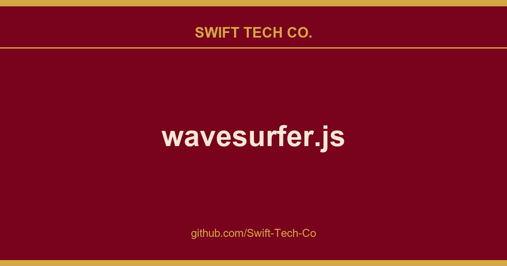

# wavesurfer.js

## What This Is

We keep a working index for product and engineering, and wavesurfer.js is the entry that collects our notes, examples and fixes. It reflects how Swift Tech Co. actually uses this in builds and client work.

## Images

[](https://github.com/Swift-Tech-Co/wavesurfer.js)

## Getting started

Install and import the package:

```bash
npm install --save wavesurfer.js
```
```js
import WaveSurfer from 'wavesurfer.js'
```

Alternatively, insert a UMD script tag which exports the library as a global `WaveSurfer` variable:
```html
<script src="https://github.com/Swift-Tech-Co/wavesurfer.js"></script>
```

Create a wavesurfer instance and pass various options:
```js
const wavesurfer = WaveSurfer.create({
  container: '#waveform',
  waveColor: '#4F4A85',
  progressColor: '#383351',
  url: '/audio.mp3',
})
```

To import one of the plugins, e.g. the Regions plugin:
```js
import Regions from 'wavesurfer.js/dist/plugins/regions.esm.js'
```

Or as a script tag that will export `WaveSurfer.Regions`:
```html
<script src="https://github.com/Swift-Tech-Co/wavesurfer.js"></script>
```

See more examples.

## Documentation

See the wavesurfer.js guide on our website for beginner-friendly, practical documentation covering common use cases, plugins, framework integration, and troubleshooting.

## API reference

The full generated API reference lives at wavesurfer.xyz/docs/api:

 * methods
 * options
 * events

## Plugins

We maintain a number of official plugins that add various extra features:

 * Regions  visual overlays and markers for regions of audio
 * Timeline  displays notches and time labels below the waveform
 * Minimap  a small waveform that serves as a scrollbar for the main waveform
 * Envelope  a graphical interface to add fade-in and -out effects and control volume
 * Record  records audio from the microphone and renders a waveform
 * Hover  shows a vertical line and timestmap on waveform hover

## Advanced / reactive API

Beyond the imperative `wavesurfer.on(...)` events, v8 exposes a small reactive
surface for apps that want to read state instead of tracking it themselves:

```js
const state = wavesurfer.getState()

state.isPlaying.subscribe((playing) => console.log('playing:', playing))
console.log(state.loadPhase.value) // 'idle' | 'fetching' | 'decoding' | 'ready' | 'error'

const { startTime, endTime } = wavesurfer.getRenderer().getVisibleRange().value
```

`getState()` returns read-only `Signal` objects
(`.value` to read, `.subscribe(fn)` to watch) for things like `currentTime`,
`isPlaying`, `volume`, `muted`, `loadPhase` and `scrollPosition`.
`getRenderer().getVisibleRange()` is a derived signal with the currently visible
`{startTime, endTime}` of the viewport, useful for plugins that need to sync to
what's on screen (e.g. a custom minimap or timeline).

If you're writing a plugin, `WaveSurfer.definePlugin(name, (ctx, options) => api)`
is an alternative to subclassing `BasePlugin`: `ctx` gives you `{ wavesurfer, scope, state, emit }`,
and anything you register on `ctx.scope` (listeners, timers, child scopes) is torn
down automatically on `destroy()`  no manual cleanup array required.

```js
import WaveSurfer from 'wavesurfer.js'

const MyPlugin = WaveSurfer.definePlugin('MyPlugin', (ctx, options) => {
  ctx.scope.listen(ctx.wavesurfer.getWrapper(), 'click', () => ctx.emit('my-event'))
  return { doSomething: () => {} }
})
```

The Spectrogram plugin accepts
a `rendering: 'windowed'` option for very long audio files: it renders only the
visible time range and evicts off-screen segments, instead of computing the
whole file's frequency data up front.

```js
SpectrogramPlugin.create({ rendering: 'windowed', /* ...other options */ })
```

This replaces the standalone `WindowedSpectrogramPlugin` (`spectrogram-windowed.js`),
which is now deprecated in favor of the merged option above  it's kept working
as a thin backward-compatible shim, but new code should use `SpectrogramPlugin`
directly.

## CSS styling

wavesurfer.js v7 is rendered into a Shadow DOM tree. This isolates its CSS from the rest of the web page.
However, it's still possible to style various wavesurfer.js elements with CSS via the `::part()` pseudo-selector.
For example:

```css
#waveform ::part(cursor):before {
  content: '🏄';
}
#waveform ::part(region) {
  font-family: fantasy;
}
```

You can see which elements you can style in the DOM inspector  they will have a `part` attribute.
See this example to play around with styling.

## Questions

Have a question about integrating wavesurfer.js on your website? Feel free to ask in our Discussions forum.

However, please keep in mind that this forum is dedicated to wavesurfer-specific questions. If you're new to JavaScript and need help with the general basics like importing NPM modules, please consider asking ChatGPT or StackOverflow first.

### FAQ

<details>
  <summary>I'm having CORS issues</summary>
  Wavesurfer fetches audio from the URL you specify in order to decode it. Make sure this URL allows fetching data from your domain. In browser JavaScript, you can only fetch data eithetr from <b>the same domain</b> or another domain if and only if that domain enables <a href="https://github.com/Swift-Tech-Co/wavesurfer.js">CORS</a>. So if your audio file is on an external domain, make sure that domain sends the right Access-Control-Allow-Origin headers. There's nothing you can do about it from the requesting side (i.e. your JS code).
</details>

<details>
  <summary>Does wavesurfer support large files?</summary>
  Since wavesurfer decodes audio entirely in the browser using Web Audio, large clips may fail to decode due to memory constraints. We recommend using pre-decoded peaks for large files (see <a href="https://github.com/Swift-Tech-Co/wavesurfer.js">this example</a>). You can use a tool like <a href="https://github.com/Swift-Tech-Co/wavesurfer.js">audiowaveform</a> to generate peaks.
</details>

<details>
  <summary>What about streaming audio?</summary>
  Streaming audio is supported only with <a href="https://github.com/Swift-Tech-Co/wavesurfer.js">pre-decoded peaks and duration</a>.
</details>

<details>
  <summary>There is a mismatch between my audio and the waveform. How do I fix it?</summary>
  If you're using a VBR (variable bit rate) audio file, there might be a mismatch between the audio and the waveform. This can be fixed by converting your file to CBR (constant bit rate).
  <p>Alternatively, you can use the <a href="https://github.com/Swift-Tech-Co/wavesurfer.js">Web Audio shim</a> which is more accurate.</p>
</details>

<details>
  <summary>How do I connect wavesurfer.js to Web Audio effects?</summary>
Generally, wavesurfer.js doesn't aim to be a wrapper for all things Web Audio. It's just a player with a waveform visualization. It does allow connecting itself to a Web Audio graph by exporting its audio element (see <a href="https://github.com/Swift-Tech-Co/wavesurfer.js">this example</a>) but nothign more than that. Please don't expect wavesurfer to be able to cut, add effects, or process your audio in any way.
</details>

<details>
  <summary>Why does my waveform look asymmetrical?</summary>
  By default, wavesurfer.js renders stereo audio as a single waveform, with the left channel on the top half and the right channel on the bottom half. If your audio has hard-panned sounds, this will result in an asymmetrical waveform.
  To render each channel separately, use the <code>splitChannels</code> option.
</details>

## Development

To get started with development, follow these steps:

 1. Install dev dependencies:

```
yarn
```

 2. Start the TypeScript compiler in watch mode and launch an HTTP server:

```
yarn start
```

This command will open https://github.com/Swift-Tech-Co/wavesurfer.js in your browser with live reload, allowing you to see the changes as you develop.

## Tests

The tests are written in the Cypress framework. They are a mix of e2e and visual regression tests.

To run the test suite locally, first build the project:
```
yarn build
```

Then launch the tests:
```
yarn cypress
```

## Feedback

We appreciate your feedback and contributions!

If you encounter any issues or have suggestions for improvements, please don't hesitate to post in our forum.

We hope you enjoy using wavesurfer.js and look forward to hearing about your experiences with the library!

---

## Swift Tech Co.

Built and maintained by Swift Tech Co.

AI Automation | FinTech Platforms | Custom Software and Mobile Apps | SaaS Platforms | Cloud Infrastructure | Cybersecurity | SEO and Marketing | API Integration

**Join our community on Telegram:** [t.me/+Qt_eFvkb2rliMzNh](https://t.me/+Qt_eFvkb2rliMzNh)

Home | Services | Careers | Referral Program | Influencers | About | Contact

**Connect**

- Website: https://github.com/Swift-Tech-Co/wavesurfer.js
- LinkedIn: [linkedin.com/in/stephenoladoke](https://www.linkedin.com/in/stephenoladoke/)
- LinkedIn (Company): [linkedin.com/company/swift-tech-co](https://www.linkedin.com/company/swift-tech-co)
- X: [@MrOladoke](https://x.com/MrOladoke)
- Instagram: [@mr.oladoke](https://www.instagram.com/mr.oladoke/)
- Instagram (Company): [@swifttechco](https://www.instagram.com/swifttechco/)
- Organization: [github.com/Swift-Tech-Co](https://github.com/Swift-Tech-Co)

## Sources

Compiled and maintained from upstream [katspaugh/wavesurfer.js](https://github.com/katspaugh/wavesurfer.js) under permissive open-source license.

---

Maintained by [Swift Tech Co.](https://github.com/Swift-Tech-Co) - [Telegram](https://t.me/+Qt_eFvkb2rliMzNh)

## Sources

Compiled and maintained from upstream [katspaugh/wavesurfer.js](https://github.com/katspaugh/wavesurfer.js) under permissive open-source license.

---

Maintained by [Swift Tech Co.](https://github.com/Swift-Tech-Co) - [Telegram](https://t.me/+Qt_eFvkb2rliMzNh)